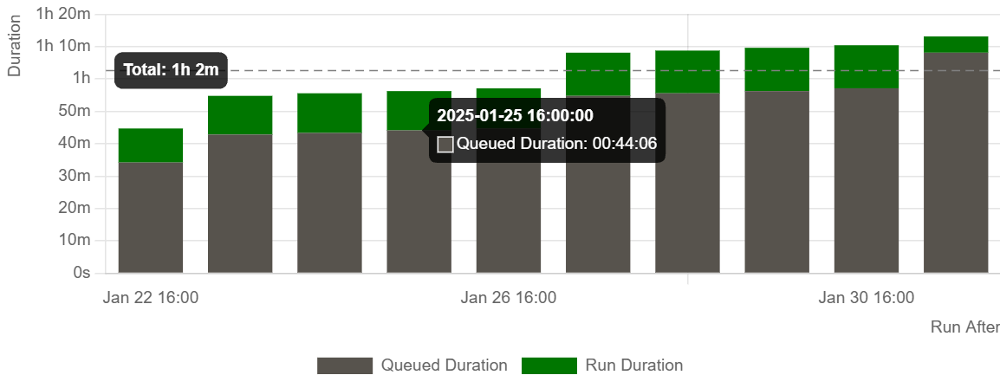
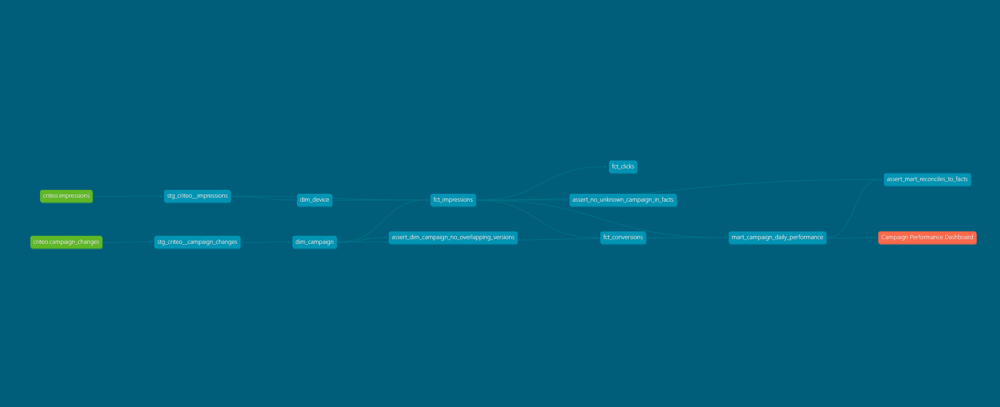
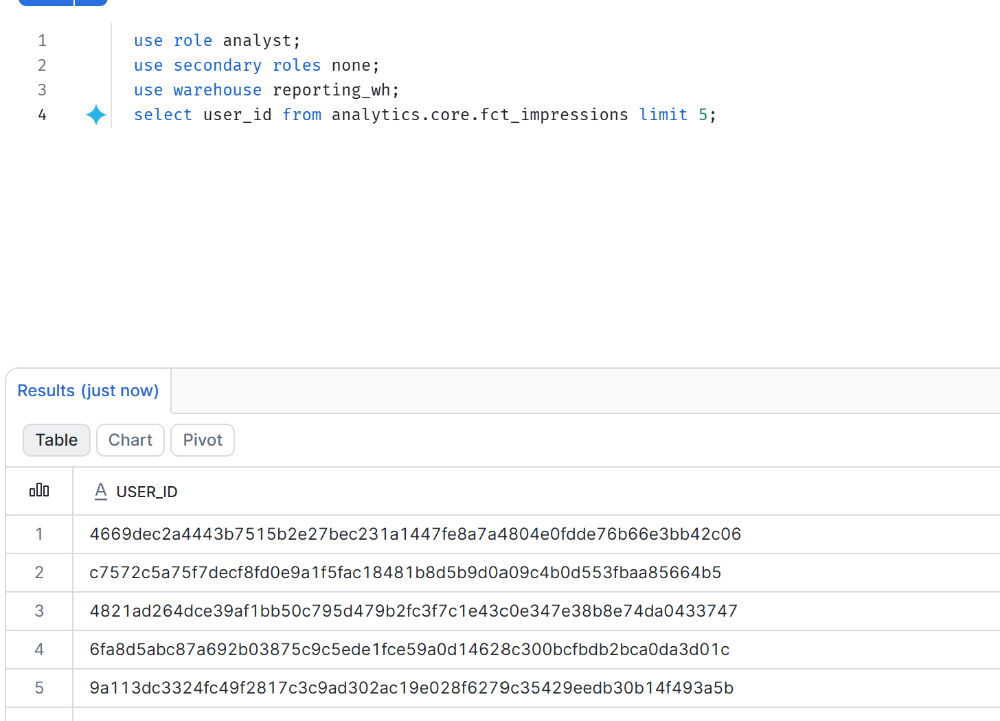
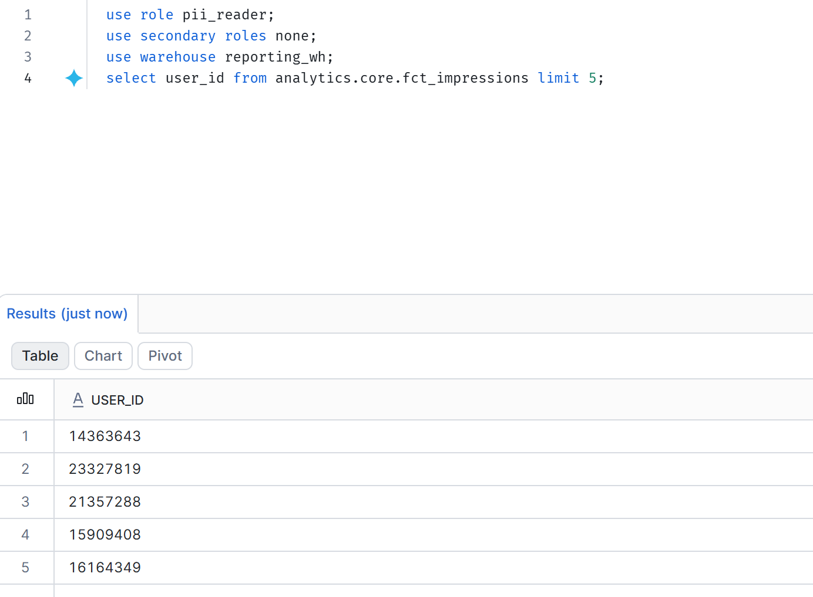

# Ad Analytics Warehouse

A pipeline that turns 16.5M raw ad impressions into a governed star schema in Snowflake. The **batch path** shows Spark tuning with measured before/after results, dimensional modeling (including SCD Type 2), data governance and orchestration. The **streaming path** adds Kafka → Spark Structured Streaming → Snowflake with an enforced data contract, a dead-letter queue, event-time watermarks and exactly-once effects in the warehouse (see [Streaming path](#streaming-path-kafka--spark-structured-streaming--snowflake)).

```
Criteo TSV (623 MB gz)
   │  include/scripts/land_raw_to_s3.py
   ▼
S3  raw/criteo/impressions/dt=YYYY-MM-DD/part-*.tsv.gz  (+ _SUCCESS)
   │  include/spark/clean_impressions.py   (dedupe, cast, quarantine, broadcast join, right-sized Parquet)
   ▼
S3  clean/criteo/impressions/dt=YYYY-MM-DD/*.parquet      clean/criteo/quarantine/...
   │  include/sql/load_impressions_day.sql (delete partition + COPY INTO, idempotent)
   ▼
Snowflake RAW.CRITEO.IMPRESSIONS ──► dbt (include/dbt) ──► ANALYTICS
                                       staging  →  core (star schema)  →  marts
                                       dim_campaign (SCD2), dim_date, dim_device
                                       fct_impressions, fct_clicks, fct_conversions
                                       mart_campaign_daily_performance (CTR, CVR, spend)

Airflow 3 (Astro CLI) runs one DAG run per day: sensor → Spark → load → freshness → dbt build → docs

Streaming path (same impression_id, same RAW schema, reconciled against batch by a dbt test)
ad server ──► Kafka ad.impressions.v1 ──► Spark Structured Streaming ──► Snowflake RAW.CRITEO
  (producer validates    (6 partitions,     contract check → DLQ          IMPRESSIONS_STREAM   (MERGE on impression_id)
   against the data       keyed by           watermark + dedupe            CAMPAIGN_MINUTE_METRICS (1-min windows)
   contract)              campaign_id)       1-min windows                 IMPRESSIONS_DLQ, STREAM_* metrics
```

| Requirement | Where it lives |
|---|---|
| Raw files in S3, partitioned by date | `include/scripts/land_raw_to_s3.py` |
| PySpark clean: dedupe, cast, partitioned Parquet | `include/spark/clean_impressions.py` |
| Broadcast joins, salting, partition sizing, before/after timings | `clean_impressions.py` (`--mode baseline/tuned`), `include/spark/benchmark.py` |
| Load into Snowflake | `include/snowflake/01_*.sql`, `include/sql/load_*.sql` |
| dbt star schema, SCD2, marts | `include/dbt/models/` |
| Tests: unique, not_null, relationships, freshness | `include/dbt/models/**/_*.yml`, `include/dbt/tests/` |
| Masking policy on user IDs | `include/snowflake/02_governance.sql`, `include/dbt/macros/apply_pii_tags.sql` |
| Role-based access | `00_account_setup.sql`, `02_governance.sql`, `grants:` in `dbt_project.yml` |
| Lineage docs | `dbt docs`, published to S3 by the DAG; `exposures` in `_reporting.yml` |
| Airflow with retries, SLAs, backfills | `dags/ad_analytics_daily.py`, `plugins/alerting.py` |
| Streaming ingestion: Kafka → Spark Structured Streaming → Snowflake | `include/streaming/`, `include/snowflake/03_streaming.sql`, `docker-compose.streaming.yml` |
| Data contract, enforced at producer and consumer, with a CI compatibility gate | `include/streaming/contracts/ad_impression_event.yaml`, `contract.py`, `check_contract.py` |


## Repo layout

This repo is an Astro project: `astro dev start` works from the root.

```
dags/ad_analytics_daily.py         the DAG
plugins/alerting.py                failure + deadline (SLA) callbacks
include/scripts/                   synthetic data generator, S3 landing
include/spark/                     cleaning job, benchmark, shared session config
include/snowflake/                 one-time account, S3 integration, governance SQL
include/sql/                       per-run load SQL (templated by Airflow)
include/dbt/                       dbt project
include/streaming/                 Kafka producer, Spark Structured Streaming job, sinks, data contract
tests/                             Spark, contract and streaming tests (pytest), real-Kafka integration test,
                                   DAG integrity tests (astro dev pytest)
Dockerfile, requirements.txt, packages.txt, airflow_settings.yaml   Astro image + pools
```

## Data caveats

- **Dates are anchored.** Criteo timestamps are seconds from the first impression. Every component anchors day 0 to `CRITEO_ANCHOR_DATE` (default `2025-01-01`), giving 31 daily partitions: 2025-01-01 to 2025-01-31 (the last impressions fall just past midnight of day 30).
- **There is no device field.** `dim_device` uses `cat1`, an undisclosed low-cardinality contextual feature, as a device/placement segment proxy. The modeling pattern (natural key, surrogate key, unknown member) is the real thing; the semantics are a stand-in.
- **Campaign attributes are simulated.** Criteo campaigns are bare IDs. The landing script generates a seeded change log: the initial state plus 0–3 changes per campaign to budget tier, bid strategy or daily budget. That gives `dim_campaign` genuine SCD2 history.
- **Cost is transformed.** Criteo rescaled `cost` and `cpo`. Spend, CPC and CPA are internally consistent but are not dollars.
- **Conversions are sparse.** About 45K conversions across 16.5M impressions, so daily CVR per campaign is noisy.

## Setup

**On Windows (PowerShell):** use `.\run.ps1 <task>` wherever this README says `make <task>`. Run `.\run.ps1 setup` once first.

### 0. Prerequisites

- Docker and the [Astro CLI](https://www.astronomer.io/docs/astro/cli/install-cli)
- Python 3.12 locally (for landing and benchmarks), Java 17 or newer (for local PySpark)
- An AWS account and an S3 bucket in one region
- A Snowflake free trial on the **Enterprise** edition. Masking policies don't exist on Standard, so choose Enterprise at signup. Pick AWS in the same region as your bucket.
- The [Snowflake CLI](https://docs.snowflake.com/en/developer-guide/snowflake-cli/index) (`snow`), connected with your own user

### 1. Get the data

Download the zip from the [Criteo dataset page](https://ailab.criteo.com/criteo-attribution-modeling-bidding-dataset/) and put `criteo_attribution_dataset.tsv.gz` in `data/`. The dataset is CC BY-NC-SA 4.0, so cite it in your README and don't commit it.

To work without it first, run `make sample land-local spark-local`. That makes a 500K-row synthetic file in the same format (skewed campaigns, duplicates and bad rows included) and runs it locally.

### 2. AWS

1. Create the bucket, for example `yourname-ad-analytics`.
2. Create an IAM user for the pipeline (Airflow and Spark) with this policy, and put its keys in `.env`:
   ```json
   {"Version": "2012-10-17", "Statement": [
     {"Effect": "Allow", "Action": ["s3:ListBucket"], "Resource": "arn:aws:s3:::YOUR_BUCKET"},
     {"Effect": "Allow", "Action": ["s3:GetObject", "s3:PutObject", "s3:DeleteObject"],
      "Resource": "arn:aws:s3:::YOUR_BUCKET/*"}]}
   ```
3. Create an IAM role for Snowflake, `snowflake-criteo-reader`, with read-only access to `clean/criteo/*` and `raw/criteo/campaign_changes/*`, plus `s3:ListBucket`. Use a temporary trust policy for now; you'll fix it in step 4.

### 3. Land the raw file

```bash
cp .env.example .env    # fill in AWS values and S3_BUCKET
set -a; source .env; set +a
pip install pandas boto3
make land-s3            # about 10 minutes; prints row, day and campaign counts
```

### 4. Snowflake

```bash
# key pair for the service user (unencrypted for local dev; use a passphrase for anything real)
mkdir -p include/secrets
openssl genrsa 2048 | openssl pkcs8 -topk8 -inform PEM -out include/secrets/rsa_key.p8 -nocrypt
openssl rsa -in include/secrets/rsa_key.p8 -pubout -out include/secrets/rsa_key.pub
export SVC_PUBLIC_KEY=$(grep -v -- '-----' include/secrets/rsa_key.pub | tr -d '\n')
export AWS_ROLE_ARN=arn:aws:iam::<account-id>:role/snowflake-criteo-reader
export HASH_SALT=$(openssl rand -hex 24)
make snowflake-setup
```

Then **connect Snowflake to S3**. In Snowflake, run `desc integration s3_criteo_int;` and copy `STORAGE_AWS_IAM_USER_ARN` and `STORAGE_AWS_EXTERNAL_ID` into the IAM role's trust policy:

```json
{"Version": "2012-10-17", "Statement": [{"Effect": "Allow",
  "Principal": {"AWS": "<STORAGE_AWS_IAM_USER_ARN>"},
  "Action": "sts:AssumeRole",
  "Condition": {"StringEquals": {"sts:ExternalId": "<STORAGE_AWS_EXTERNAL_ID>"}}}]}
```

Check it with `list @raw.criteo.clean_stage;`. That works (empty) once the trust policy is right.

### 5. Run Airflow

Fill in the Snowflake part of `.env` (account identifier and key path), and put the same account identifier in `airflow_settings.yaml` (connection `snowflake_loader`). Then:

```bash
astro dev start          # first build downloads Java, dbt and the hadoop-aws jars; it takes a while
make backfill            # all 31 days, 4 runs in flight
```

Open http://localhost:8080 to watch it. Each day runs the sensor, Spark, the two loads, freshness, the dbt build and docs.

### 6. Verify

```sql
use role analyst;  use warehouse reporting_wh;
select * from analytics.marts.mart_campaign_daily_performance order by spend desc limit 20;
select user_id from analytics.core.fct_impressions limit 5;      -- 64-char hashes

use role pii_reader;                                             -- grant it to yourself first
select user_id from analytics.core.fct_impressions limit 5;      -- real IDs

select * from analytics.core.dim_campaign where campaign_id = <a campaign with changes> order by valid_from;
```

To see lineage, open `s3://<bucket>/dbt-docs/index.html` (download it, or front it with S3 static hosting), or run `make dbt-docs` locally.

## Spark tuning results

Measured on the full dataset (16,468,027 impressions, 31 daily partitions), PySpark 4.2 in local mode (`local[4,4]`, 12 GB driver) on a 14-core Windows laptop, reading and writing local disk. One run per configuration (join timings after a warm-up run), so treat small differences such as AQE vs. sort-merge as within noise. Raw output: [`docs/benchmark_results.md`](docs/benchmark_results.md).

### A. Cleaning job: read gzip TSV, cast, dedupe, write Parquet partitioned by day

| Mode | Runtime | Output files | Rows out |
|---|---|---|---|
| Baseline (Spark defaults) | 540 s | 6,200 | 16,468,027 |
| Tuned | 344 s | 31 | 16,468,027 |
| **Change** | **1.57× faster** | **200× fewer files** | identical |

- **The biggest win is file count, not runtime.** With defaults, Spark shuffles into 200 partitions, and each partition writes one file for every day it touches: 200 × 31 = 6,200 small files. The tuned job sizes output to about 128 MB per file, which here is one file per day. Every downstream reader benefits: Snowflake `COPY INTO` makes one request per file, and Parquet readers pay a fixed cost to open each file.
- **The baseline also crashed the Spark JVM on the first attempt** with all 14 cores running. The likely cause is memory: each task keeps up to 31 Parquet writers open at once, and each writer buffers a row group. Capping concurrency at 4 tasks with a 12 GB driver let it finish. The tuned job doesn't have this problem, because each task writes to exactly one day.
- **Runtime gains come from** parsing the gzip once instead of twice (cached and reused for the clean and quarantine outputs), broadcasting the campaign lookup, and sizing shuffle partitions to the data.
- **Criteo's published file is already clean:** zero duplicates and zero bad rows. The dedupe and quarantine logic still runs, and the synthetic test data (with injected duplicates and malformed rows) is what verifies it.

### B. Joining impressions to a campaign × day attribute table

| Strategy | Runtime | vs default |
|---|---|---|
| Sort-merge join (default) | 11.6 s | baseline |
| AQE skew-join handling | 10.4 s | 1.1× faster |
| Salted keys (23 hot campaigns × 16 buckets) | 13.7 s | 1.2× **slower** |
| **Broadcast join** | **3.9 s** | **2.9× faster** |

- **Broadcast wins because the dimension side is tiny,** about 21K campaign-day rows. Sending it to every task means the 16.5M impressions are never shuffled at all.
- **Salting lost, and that's the expected result here.** Skew in this dataset is moderate: the top campaign has 2.7% of impressions and the top 10 have 18.6%. No single task is a severe straggler, so splitting hot keys only adds cost (16 copies of their dimension rows plus an extra join column) without removing a bottleneck.
- **AQE barely helped for the same reason:** no partition was large enough to cross its skew threshold, so it had little to split.
- **When salting would win:** when both sides are too large to broadcast, and one key holds a large share of rows (say 20–50%) and creates a straggler task that AQE's automatic split can't fix. The decision order is broadcast first, then AQE, then salt by hand.

## Spark tuning: the levers

These are the settings that differ between the two modes:

| Lever | Baseline | Tuned | Why it matters |
|---|---|---|---|
| Output files | 200 shuffle partitions → up to 200 tiny files per day | `files_per_day = ceil(estimated Parquet bytes / 128 MB)`, one shuffle on `(dt, bucket)` | Small files slow every reader, including Snowflake COPY. Expect file count to drop by 2 orders of magnitude. |
| Shuffle partitions | 200 default | sized to input (~128 MB each, at least the core count) | Too many partitions means scheduling overhead; too few means spills. |
| Broadcast join | disabled → sort-merge join shuffles every impression | campaign list explicitly broadcast | No shuffle of the 16.5M-row side at all. |
| Reuse | gzip parsed twice (clean and quarantine writes) | typed frame persisted once | Parsing gzip TSV is the most expensive step. |
| Input splits | n/a | landing writes several gzip parts per day | gzip isn't splittable: one file means one task. |
| Sort within files | none | `campaign_id, event_ts` | Tighter Parquet min/max stats, better compression and pruning. |

The **skewed join** benchmark compares `sort_merge`, `salted`, `aqe_skew_join` and `broadcast` on a join of impressions to a campaign × day attribute table. The top Criteo campaigns hold a large share of impressions, so plain sort-merge sends those keys to a few tasks. The salted version splits only the hot campaigns (more than 5× the average) into N buckets and replicates their dimension rows N times.

To reproduce: `python include\spark\benchmark.py --raw-root <landing folder> --clean-root data\bench --repeats 1 --out docs\benchmark_results.md`. Add `--scale 10` to inflate the impressions and see how the join strategies behave at larger scale.

`GZ_TO_PARQUET_RATIO` (default 1.1) converts gzip bytes into an estimate of Parquet size. After your first full run, compare the actual Parquet size to the input and update it.

## Modeling decisions

| Table | Grain | Load |
|---|---|---|
| `fct_impressions` | one impression | dbt microbatch, daily batches on `event_ts` |
| `fct_clicks` | one click (Criteo: at most 1 per impression) | microbatch |
| `fct_conversions` | one conversion | full rebuild (paths span days; about 45K rows) |
| `dim_campaign` | one campaign version (SCD2) | full rebuild from change log |
| `dim_date` | one day | `dbt_utils.date_spine` |
| `dim_device` | one cat1 segment | full rebuild |
| `mart_campaign_daily_performance` | campaign × day | table |

- **SCD2 from a change log, not a snapshot.** dbt snapshots only record changes they observe at run time and can't be replayed in a backfill. The source here is already an event log, so validity windows come from `lead()`, which is deterministic and fully rebuildable. Facts join the version in effect at `event_ts` (`valid_from <= ts < valid_to`). A singular test checks that windows have no gaps or overlaps and that each campaign has one current version.
- **Unknown members** (`'-1'`) in every dimension, so facts never hold NULL foreign keys and relationships tests stay meaningful.
- **Attribution.** Each conversion is credited to the last *clicked* impression before it, falling back to last touch. `is_attributed_to_criteo` keeps Criteo's own label.
- **Microbatch** means a rerun of any day rebuilds exactly that day's rows. Airflow passes `--event-time-start/--event-time-end`.
- **Mart dating convention.** Delivery is dated by impression day and conversions by conversion day. This is documented in the model.

## Governance

- **Tests.** 75 dbt tests (63 batch + 12 streaming, including the stream/batch reconciliation) (`dbt ls --resource-type test`, checked in CI): `unique`, `not_null`, `relationships` from every fact FK to its dimension, `accepted_values`, ranges (CTR between 0 and 1), SCD2 integrity, and a reconciliation test checking that mart totals equal fact totals. Failures are stored in a `test_failures` schema so you can query the bad rows.
- **Freshness.** On `_loaded_at`: warn after 26h, error after 50h. The DAG runs it before the dbt build.
- **Masking.** This is **tag-based**. One tag, `governance.tags.pii_type`, has the masking policy attached. dbt re-tags columns marked `meta: {pii: user_id}` after every build (`create or replace` drops tags). Analysts see a salted SHA-256 pseudonym, so distinct-user counts and joins still work but the ID can't be recovered. `PII_READER` sees real values. The pipeline roles see real values because they move the data.
- **RBAC.** Functional roles: `LOADER` writes RAW, `TRANSFORMER` reads RAW and writes ANALYTICS, `ANALYST` reads core and marts, `PII_READER` unmasks, `GOVERNANCE_ADMIN` owns policies. Warehouses are separated per workload. Analyst grants are in dbt config, so access is versioned with the models. `PII_READER` deliberately doesn't roll up to `SYSADMIN`.
- **Lineage.** `dbt docs` with an exposure for the dashboard, regenerated and published each run.

## Orchestration

- **Retries.** Two per task, with exponential backoff capped at 20 minutes. The failure alert fires only after the last retry.
- **SLAs.** Airflow 3 removed the old `sla=` feature, so this uses **Deadline Alerts**, its replacement. They are DAG-level, and the docs mark them experimental. There are two tiers: warn at 90 minutes after the run is queued, page at 3 hours. The reference is queued time, not logical date, so a backfill of January 2025 doesn't fire 30 instant misses. Each task also has an `execution_timeout` as a hard stop.
- **Backfills.** Every task is keyed on `{{ ds }}` and idempotent: Spark uses dynamic partition overwrite, Snowflake uses delete + `COPY ... FORCE` in one transaction, and dbt uses microbatch. `catchup=False`, so history loads through an explicit `airflow backfill create` (see `make backfill` and `make backfill-day`).
- **Pools.** Spark runs in local mode inside the worker, so `spark_local` has 1 slot. All Snowflake and dbt writes share `warehouse_writes` (1 slot), so full-rebuild models never race. Sensors and Spark for other days still overlap.
- **Reschedule-mode sensor.** It frees the worker slot between checks for `_SUCCESS`.

## Results

- **16.5M impressions** across 31 daily partitions, loaded S3 → Spark → Snowflake → dbt by Airflow
- **Spark tuning:** cleaning job 1.57× faster, output files cut from 6,200 to 31; broadcast join 2.9× faster than sort-merge and 3.5× faster than salting (single runs)
- **Governance:** `user_id` masked by tag-based policy. Analysts see a SHA-256 pseudonym, `PII_READER` sees the real value

| Airflow: 31 daily runs | dbt lineage |
|---|---|
|  |  |

| Analyst view (masked) | PII reader view |
|---|---|
|  |  |


## Streaming path: Kafka → Spark Structured Streaming → Snowflake

The batch DAG lands each day once it is complete. The streaming path makes impressions queryable within seconds of being served, without giving up the batch path's guarantees.

### Data contract
[`include/streaming/contracts/ad_impression_event.yaml`](include/streaming/contracts/ad_impression_event.yaml) is the single source of truth for the event: fields, types, required/optional, constraints, PII tags, owner, consumers, topic and key, SLOs and compatibility rules. Everything else is generated from it:

| Side | What it gets from the contract | Behavior |
|---|---|---|
| Producer (`producer.py`) | JSON Schema | Validates every event before sending; invalid events are never published. |
| Consumer (`stream_impressions.py`) | Spark schema + rules | Parses with the contract schema; any violation goes to `IMPRESSIONS_DLQ` with a reason code instead of being dropped or loaded. |
| CI (`check_contract.py`) | Old vs new contract | Blocks removed or retyped fields, new required fields, optional↔required flips, tightened constraints and key changes, unless the change bumps the major version **and** moves to a new topic (`ad.impressions.v2`). Adding an optional field needs a minor bump. |

Consumer reason codes, checked in order (first failure wins): `invalid_json`, `type_mismatch`, `unsupported_schema_version`, `missing_required:<field>`, `constraint:<field>:<rule>`, then quality rules `quality:campaign_known` (same rule as the batch job's `unknown_campaign`) and `quality:not_from_future`.

### Delivery semantics

| Concern | How it's handled |
|---|---|
| Offsets | Kafka offsets live in the Structured Streaming checkpoint; a restart resumes exactly where it stopped (tested against a real broker). |
| Duplicates (producer retries, replays) | `foreachBatch` is at-least-once, so every write is a `MERGE` on a natural key: `impression_id` for impressions, `(topic, partition, offset)` for the DLQ, `(campaign_id, window_start)` for aggregates. A replayed batch is a no-op. A test deletes the checkpoint, re-reads everything, and checks the warehouse is unchanged. |
| Late events | The raw table never drops data. The minute aggregates use a 10-minute event-time watermark: Spark drops a row as late when it is older than the **previous** micro-batch's watermark, so rows between the previous and current watermark still count, and no window is ever emitted twice. Dropped rows are counted in `STREAM_QUERY_PROGRESS`; the batch path and dbt remain the source of truth. |
| Same key as batch | The producer computes `impression_id` exactly as the batch Spark job does (SHA-256 of the raw row). A test proves both paths produce identical keys, and the dbt test `assert_stream_reconciles_to_batch` reconciles them row for row for every closed day both loaded. |
| Observability | `STREAM_BATCH_METRICS` (rows in/valid/DLQ, duplicates, latency p50/p95, DLQ rate per batch) and `STREAM_QUERY_PROGRESS` (throughput, batch duration, rows dropped by watermark, state size, from a `StreamingQueryListener`). dbt source freshness on `_ingested_at`: warn after 5 minutes, error after 15. |

**Why MERGE through the Python connector, not the spark-snowflake connector?** Micro-batches are seconds of events, the Python connector needs no JVM jar matched to the Spark/Scala build, and `write_pandas` into a temp table + one `MERGE` in a transaction gives exactly-once effects. At much higher volume (tens of thousands of events per second), Snowpipe Streaming through the Snowflake Kafka connector is the better tool: lower cost and latency, with no Spark cluster to run.

### Run it

```bash
pip install -r requirements-streaming.txt
make sample land-local          # synthetic data + campaign list (as for the batch path)

make stream-local               # no broker: Kafka-shaped files -> Spark -> DuckDB, prints table counts

make kafka-up                   # or with real Kafka (Docker): single-node KRaft + UI on :8085
make stream-produce             # replays 100K events at 2K/s with 1% injected faults
make stream-run                 # Spark Structured Streaming, 10 s triggers, DuckDB sink

make snowflake-streaming        # Snowflake: create the RAW streaming tables once
make stream-run STREAM_SINK=snowflake   # same job, MERGEs into RAW.CRITEO as LOADER
```

### Tests
- `tests/test_contract.py` (23 tests): schema generation, producer validation of each fault type, forward compatibility, and every compatibility-gate rule.
- `tests/test_streaming.py` (12 tests): end to end on 20K events with 2% injected faults, 2% duplicates and 1% late events. It checks that every accepted impression lands exactly once (late ones included) and every fault type hits the DLQ with the right reason. **The minute aggregates must match an independent pandas model of Spark's watermark semantics exactly**, window by window. It also covers checkpoint restart, full replay without a checkpoint (warehouse unchanged), batch/stream key parity, the Snowflake sink's stage → MERGE → commit/rollback sequence, and the sink schema against `03_streaming.sql`.
- `tests/integration/test_kafka_e2e.py`: a real Kafka broker (CI service container) with 6 partitions. It produces, streams, produces more, and streams again from the checkpoint; every record must be read exactly once.

### Measured locally (500K events)
500K-row synthetic file, 1% faults, 1% duplicates, 0.5% late; PySpark 4.2 local mode on a **2-vCPU** container; DuckDB sink; 10 micro-batches of about 50K events.

| | |
|---|---|
| Raw query | median 4.9K events/s per micro-batch (10.7 s per 50K batch; the `toPandas` + MERGE step dominates) |
| Aggregate query | median 7.1K events/s, peak state 84K rows (RocksDB state store) |
| Correctness | 494,963 unique impressions loaded (no duplicates), 5,092 rejects in the DLQ (= injected faults), 1,994 late rows excluded from the minute aggregates but present in raw |

These are single-machine numbers for a backlog replay, not a cluster benchmark. The reported latency in that run (about 90 s p50) is mostly time spent waiting in the backlog; in steady state it is about one trigger interval plus one batch duration.

### What is and isn't verified
- **Verified in CI:** the contract gate, everything in the test list above, and the real-Kafka round trip.
- **Not exercised in CI:** the Snowflake sink against a live account (no credentials in CI). Its SQL and transaction sequence are unit-tested with a fake connection, and the DDL is checked against the sink schema. To verify against Snowflake, run `make snowflake-streaming`, then `make stream-run STREAM_SINK=snowflake` and the dbt tests.

## Keeping it inside free tiers

- Each warehouse is XSMALL with `auto_suspend = 60`. A resource monitor suspends everything at 50 credits a month.
- A full 31-day backfill runs 31 short dbt builds. Watch `snowflake.account_usage.warehouse_metering_history`.
- S3: the raw gzip (~650 MB) plus Parquet (~800 MB) plus benchmark outputs. Delete `bench/` after benchmarking.

## Troubleshooting

- **`list @clean_stage` gives "access denied".** The IAM trust policy doesn't match `desc integration`. The external ID changes if you recreate the integration.
- **Spark can't find `S3AFileSystem`.** The image build didn't fetch the jars. Rebuild with `astro dev restart`. The hadoop-aws version is derived from PySpark's bundled Hadoop, so don't pin it by hand.
- **The tag post-hook fails with "insufficient privileges".** `02_governance.sql` wasn't run, or ran before the TRANSFORMER role existed.
- **Masking returns real IDs for an analyst.** Check `select current_role(), current_secondary_roles();`. Secondary roles count in `is_role_in_session`.
- **The backfill runs but `dbt_build` waits.** That's the `warehouse_writes` pool working as designed.


---
Data: Diemert, Meynet, Galland, Lefortier. *Attribution Modeling Increases Efficiency of Bidding in Display Advertising.* AdKDD & TargetAd, KDD 2017. CC BY-NC-SA 4.0.
